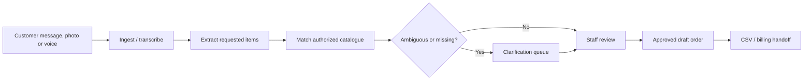

# AI Business Ideas — From Customer Problems to Scalable AI Products

> **Status:** Discovery / planning. **No production application has been built in this repository.**  
> **Primary goal:** Identify, validate, build and grow AI-enabled software businesses that solve valuable real-world problems, attract users and can generate sustainable recurring revenue.
>
> **Leading recommendation, NOT a founder-approved final decision:** An **AI Order Assistant for wholesalers and distributors**. See [decision status](PROJECT_CONTEXT.md).

## Start here (developers, designers and AI coding agents)

1. Read [AGENTS.md](AGENTS.md) for the handoff and coding rules.
2. Read [PROJECT_CONTEXT.md](PROJECT_CONTEXT.md) to distinguish conversation-backed facts from proposals and unanswered questions.
3. Read [Vision & strategy](docs/01_VISION_AND_STRATEGY.md) and the [full idea portfolio](docs/02_IDEA_PORTFOLIO.md).
4. Read the [leading product PRD](docs/03_PRIMARY_PRODUCT_PRD.md) and [user workflows](docs/04_USER_STORIES_AND_WORKFLOWS.md).
5. Review [architecture](docs/05_ARCHITECTURE.md), [data model](docs/06_DATA_MODEL.md), [API contract](docs/07_API_SPEC.md), [AI quality](docs/08_AI_PIPELINE_AND_EVALUATION.md) and [security](docs/09_SECURITY_PRIVACY.md).
6. Follow the [90-day validation roadmap](docs/12_ROADMAP_90_DAYS.md), [backlog](docs/14_DELIVERY_BACKLOG.md) and [contributing guide](CONTRIBUTING.md).

## Why this repository exists

The founder asked what AI-era business/software to create to maximize users and business growth. The strategy is to **validate a painful, frequent workflow before engineering a broad AI platform**. Favor an inexpensive demo, actual customer feedback, paid pilots, measurable ROI and responsible handling of data. AI is a means to solve the workflow, not the product's only value proposition.

## Opportunity portfolio

| Rank in Oct 28 recommendation | Idea | Customer | Potential model | Status |
| --- | --- | --- | --- | --- |
| 1 | AI Order Assistant | Wholesalers and distributors (electrical trade as a first niche to test) | B2B subscription + setup | **Lead candidate for validation**, not approved |
| 2 | Service-operations software | Local service companies | B2B subscription | Alternative |
| 3 | Job-focused AI English speaking/interview coach | Job seekers and learners | Low-cost B2C subscription | Alternative / separate exploration |
| 4 | E-commerce delivery/returns assistant | Online merchants and operators | B2B subscription | Alternative |

The pricing ideas are **test hypotheses**, not verified market facts or promises. See [portfolio](docs/02_IDEA_PORTFOLIO.md) and [pricing / go-to-market](docs/11_BUSINESS_MODEL_AND_GO_TO_MARKET.md).

## Leading product in one minute

Incoming WhatsApp-style messages, pasted text, photos, and voice notes are often messy. A wholesaler wants them turned into *catalogue-matched, unambiguous, human-reviewed draft orders*, ready to export into existing billing workflows. The assistant proposes; authorized staff confirm. **It must never silently place an order or fabricate a SKU or price.**

## Ground rules

- **Discovery before scale:** Interview ~20 prospective buyers and seek ~3 paid pilots *before* a large build.
- **Human-in-the-loop:** No automatic binding order placement in MVP.
- **Low-cost first:** Prototype with manual import, spreadsheet catalogue, simple review interface and CSV export. Avoid premature direct messaging-platform or accounting-system integrations.
- **Secure by design:** Tenant isolation, role-based access, encryption, redaction, auditability, explicit consent for data handling.
- **Measured outcomes:** Review time, correct catalogue matches, ambiguity rate, correction rate, pilot adoption, retention and revenue.
- **Honest state:** No customers, usage claims, integrations, tests, or deployment are asserted until verified.

## Repository map

- [PROJECT_CONTEXT.md](PROJECT_CONTEXT.md): history, confirmed constraints, assumptions, outstanding approvals
- [AGENTS.md](AGENTS.md): starting instructions for Codex / any contributor
- [docs/](docs/): product, engineering, security, quality, growth, and planning specifications
- [CONTRIBUTING.md](CONTRIBUTING.md): contribution, PR and acceptance standards
- [.github/](.github/): pull request / issue templates

## First contribution

Start with an interview script, a clickable demo or a **local-only prototype** of the order review flow. Do not build the entire roadmap before field validation. The next feature to implement is determined by evidence and the decision log, not by this README alone.

**Repository:** https://github.com/anneshabiswaas22-collab/ai-buissness  
**Last handoff update:** 2026-11-13. This repository preserves the earlier conversation's direction as accurately as available; proposed specifications are marked as such.