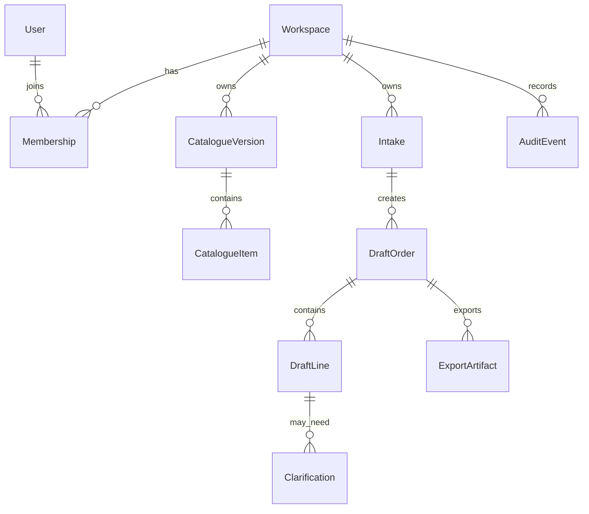

# 06 — Proposed Data Model and Storage Rules

**Status:** Design draft. Implementation must use migrations and automated tenant-isolation tests.

## Entities

| Entity | Important fields | Ownership / invariants |
| --- | --- | --- |
| Workspace | id, display_name, created_at, policy_version | One business tenant; never trust client-selected scope |
| User | id, auth_subject, status | Global identity; no stored plain-text password |
| Membership | id, user_id, workspace_id, role, revoked_at | Roles: ADMIN, OPERATOR, REVIEWER (proposal) |
| CatalogueVersion | id, workspace_id, version, status, uploaded_at | Immutable after activation; keep revision trace |
| CatalogueItem | id, workspace_id, version_id, sku, name, aliases, unit, pack_factor, active | UNIQUE(workspace_id, version_id, sku); validated units |
| Intake | id, workspace_id, created_by, kind, input_object_ref, input_text, consent_ref, status | Raw input access controlled; retention-limited |
| DraftOrder | id, workspace_id, intake_id, revision, state, created_by, approved_by, approved_at | State machine; approval refers to immutable revision |
| DraftLine | id, workspace_id, order_id, original_phrase, candidate_sku, resolved_sku, quantity, unit, evidence, resolution_state | Unknown/ambiguous never silently resolved |
| Clarification | id, workspace_id, line_id, question, answer, actor_id, timestamp | Written answer/evidence, no external auto-send in MVP |
| ExportArtifact | id, workspace_id, approved_order_revision, type, object_ref, idempotency_key, created_by | Unique workspace + idempotency key |
| AuditEvent | id, workspace_id, actor_id, action, entity_type, entity_id, change_summary, created_at | Append only; sensitive text redacted |
| UsageEvent | id, workspace_id, event_type, duration_ms, model_id, tokens_in, tokens_out, estimated_cost | Privacy-safe metrics and actual cost checks |

## Proposed relationships



## Data safety invariants

1. Every tenant-owned table has `workspace_id`; enforce at query AND database layer where possible (e.g. Postgres RLS). A resource ID alone never grants access.
2. Unique constraints for (workspace, catalogue version, SKU), (workspace, order, revision), (workspace, idempotency key).
3. Hash/export identifiers alone are not authorization; fetch through session-scoped checks and short-lived signed URLs.
4. All approvals record the exact set of line items / catalogue version / actor / timestamp and are immutable.
5. External buyer phone numbers, voice and attachments are personal/sensitive business data; store only when needed, with explicit retention and deletion plans.
6. Destructive changes to approved orders create a new revision and a new approval; do not rewrite audit history.
7. Model reasoning text is not a reliable audit record; log inputs' minimal metadata, output version, corrections and model ID safely.

## Example catalogue (synthetic; safe fixture)

```csv
sku,name,unit,aliases,pack_factor
SW-10A,10 amp switch,piece,10a switch,
SW-16A,16 amp switch,piece,16a switch,
CABLE-2.5,2.5 sq mm cable,meter,2.5mm wire,
```

Do not assume this schema matches pilot billing software. Create a pilot-specific mapping only after seeing a consented sample export.